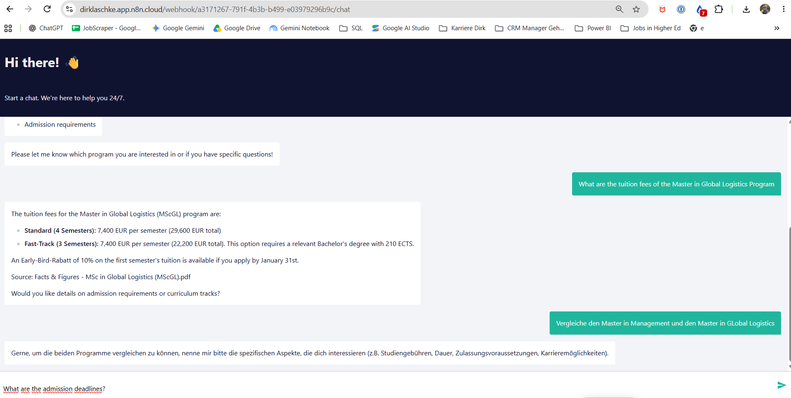

# Student Recruitment RAG Chatbot

> **Zweisprachiger KI-Chat-Assistent auf Basis von n8n und Pinecone, der Fragen von Studieninteressierten auf Deutsch und Englisch verlässlich anhand offizieller Studiengangs-PDFs beantwortet.**



[Click here to start a chat!](https://dirklaschke.app.n8n.cloud/webhook/a3171267-791f-4b3b-b499-e03979296b9c/chat)

*Zusammenspiel aus automatisierter Wissensbasis-Aktualisierung (Teil 1) und quellengestütztem Chat-Agenten (Teil 2).*

## 1. Idee & Ausgangslage

* **Problem / Ziel:** Studieninteressierte stellen regelmäßig detaillierte Fragen zu Studiengängen, Studiengebühren, Zulassungsvoraussetzungen, Fristen und Studieninhalten – häufig außerhalb regulärer Bürozeiten. Allgemeine KI-Modelle liefern ohne Dokumentenbezug oft ungenaue oder veraltete Antworten, während das manuelle Durchsuchen mehrerer Broschüren aufwendig ist.
* **Warum dieses Projekt?** Ich wollte über 20 Jahre Praxiserfahrung aus Hochschulmarketing, Student Recruitment und Zulassung mit moderner Workflow-Automatisierung, Vektorsuche und KI-Agenten verbinden – mit klaren Leitplanken gegen Halluzinationen.

## 2. Lösung im Überblick

Das System besteht aus zwei ineinandergreifenden **n8n-Workflows**, die Dokumente und Chat-Antworten sauber trennen:

1. **Automatisierte Wissensbasis (Sync-Workflow):** Sobald Programm-PDFs in Google Drive hinzugefügt oder aktualisiert werden, werden sie automatisch nach Studiengang sortiert, bereinigt und in eigene Namespaces einer **Pinecone-Vektordatenbank** geladen.
2. **Zweisprachiger Chat-Agent (RAG-Workflow):** Ein KI-Agent greift gezielt auf den passenden Studiengangs-Namespace zu, merkt sich den Gesprächsverlauf, antwortet in der Sprache der Anfrage (Deutsch oder Englisch) und nennt am Ende das konkrete Quelldokument.

```text
student-recruitment-rag-chatbot/
├── README.md                  # Projektdokumentation & Architektur-Überblick
├── assets/                    # Workflow-Screenshots & Chat-Beispiele
└── workflows/                 # Exportierte n8n-Workflows (.json)
```

## 3. Projektschritte (Ablauf der beiden Workflows)

### Teil 1: Automatischer PDF-Sync & Vektordatenbank-Update

1. **Ordner überwachen (`DriveTriggerFileCreated` & `DriveTriggerFileUpdated`):** Überwacht den Google-Drive-Ordner `campus-recruitment-hub` auf neue oder geänderte Studiengangs-PDFs.
2. **PDF herunterladen (`DownloadFile`):** Lädt die betreffende Datei zur Weiterverarbeitung in den Workflow.
3. **Studiengang erkennen (`RouteByProgram`):** Prüft den Dateinamen und ordnet das Dokument dem jeweiligen Programm zu (`BScBBA`, `MScGL`, `MScMGT`, `MScBADS`, `MBA`).
4. **Namespace & Metadaten setzen (`SetNameSpaceProgramTags`):** Vergibt einen eigenen Pinecone-Namespace (`prog-bscbba`, `prog-mscgl`, `prog-mscmgt`, `prog-mscbads`, `prog-mba`) sowie Metadaten (`program_code`, `degree_level`, `source_doc`).
5. **Alte Vektoren vor Neu-Indexierung löschen (`DeleteOldVectors` & `WaitForDelete`):** Entfernt in Pinecone gezielt bestehende Einträge zum gleichen `source_doc` im jeweiligen Namespace, damit bei PDF-Updates keine Dubletten entstehen.
6. **Zerlegen, Vektorisieren & Speichern (`TextSplitter`, `EmbeddingsWithGemini`, `Pinecone Vector Store`):** Teilt den Text in Abschnitte (900 Zeichen mit 100 Zeichen Überlappung), erzeugt Embeddings mit `models/gemini-embedding-001` und speichert sie im Index `campus-recruitment-hub`.


### Teil 2: Zweisprachiger RAG-Recruitment-Agent

1. **Chat-Nachricht empfangen (`When chat message received`):** Startet den Dialog über das n8n-Chat-Interface mit einer Begrüßung und Übersicht möglicher Themen (Fakten & Zahlen, Gebühren, Fristen, Curriculum, Zulassung).
2. **Gesprächskontext halten (`Simple Memory`):** Speichert die letzten 10 Gesprächsschritte, sodass Rückfragen ohne Wiederholung des Studiengangs möglich sind.
3. **Passenden Programmbereich durchsuchen (`search_bscbba`, `search_mscgl`, `search_mscmgt`, `search_mscbads`, `search_mba`):** Der Agent wählt je nach Frage das passende Such-Tool (oder mehrere für Programmvergleiche) und durchsucht den zugehörigen Pinecone-Namespace.
4. **Belegte Antworten generieren (`OpenRouter Chat Model — google/gemini-2.5-flash`):** Antwortet auf Deutsch oder Englisch, bleibt strikt bei den abgerufenen Dokumenteninhalten, stellt bei unklarem Studiengang eine kurze Rückfrage und zitiert am Ende `source_doc`.


<details>
<summary><strong>System-Prompt & Guardrails (Regeln gegen Halluzinationen)</strong></summary>

### Role

You are a helpful and accurate student recruitment assistant for our university's study programs.

### Core Rules

1. **Language:** Always respond in the exact language used by the prospective student (German or English).

2. **Strict Grounding:** Rely exclusively on the facts retrieved from your program search tools. Never guess, extrapolate, or invent tuition fees, deadlines, credit points, or admission requirements. If a detail is missing from the retrieved documents, state clearly that you do not have that information and recommend contacting the admissions team.

3. **Program Routing & Clarification:**
Call the dedicated search tool matching the program asked about (or multiple tools for explicit comparisons).
If the user's question does not clearly specify a study program, ask a brief clarifying question before calling a tool.

4. **Source Transparency:** At the end of your response, briefly cite the source document name(s) (`source_doc` from metadata) used to answer the question.

5. **Concise & Chat-Friendly Style:**
Keep answers brief, scannable, and directly focused on the specific question asked (aim for 80–150 words for single-program questions, unless the user explicitly asks for a full overview or multi-program comparison). Use short bullet points for key facts (fees, duration, deadlines) instead of long narrative paragraphs. Do not dump extra details from the retrieved chunks that were not asked for. At the end, offer a brief follow-up prompt (e.g., *"Would you like details on admission requirements or curriculum tracks?"*).

<details>


## 4. Verwendete Tools & Technik

* **n8n:** Orchestrierung beider Workflows und des Chat-Interfaces (Chat Trigger, AI Agent, Switch, Merge, HTTP Request, Document Loader & Text Splitter).
* **OpenRouter (`google/gemini-2.5-flash`):** Sprachmodell für dialogorientierte, zweisprachige Antworten auf Basis der abgerufenen Textpassagen.
* **Google Gemini Embeddings (`models/gemini-embedding-001`):** Erstellung der Vektor-Repräsentationen für Dokumente und Suchanfragen.
* **Pinecone (`campus-recruitment-hub`):** Vektordatenbank mit getrennten Namespaces je Studiengang (`prog-*`).
* **Google Drive:** Zentrale Dokumentenablage für die Studiengangs-PDFs.

## 5. Ergebnisse & Erkenntnisse

* **Saubere Datenaktualisierung (Idempotenz):** Durch den vorgelagerten Löschschritt (`DeleteOldVectors`) lassen sich aktualisierte Broschüren im laufenden Betrieb einspielen, ohne veraltete Textfragmente im Index mitzuschleppen.
* **Trennung nach Studiengängen:** Eigene Namespaces pro Programm verhindern, dass Informationen (z. B. Studiengebühren oder Zulassungsregeln) zwischen Bachelor-, Master- und MBA-Programmen vermischt werden.
* **Fachliche Leitplanken im Prompting:** Die Kombination aus strikter Quellenbindung, Quellenangabe (`source_doc`) und Rückfrage-Logik bei unklarem Studiengang macht die Antworten im Hochschulkontext deutlich verlässlicher als eine ungesteuerte KI-Suche.

## 6. Nächste Schritte / Roadmap

* **CRM-Übergabe:** Direkte Möglichkeit für Interessierte, Kontaktdaten zu hinterlassen oder einen Beratungstermin anzustoßen (z. B. Anbindung an HubSpot).
* **Themen- & Lückenanalyse:** Auswertung häufig gestellter Fragen und unbeantworteter Themen, um Broschüren und FAQs gezielt zu verbessern.
* **Automatisierte Qualitätstests:** Regelmäßige Testläufe mit deutschen und englischen Beispielfragen nach PDF-Updates zur Prüfung von Antwortqualität und Quellenangaben.